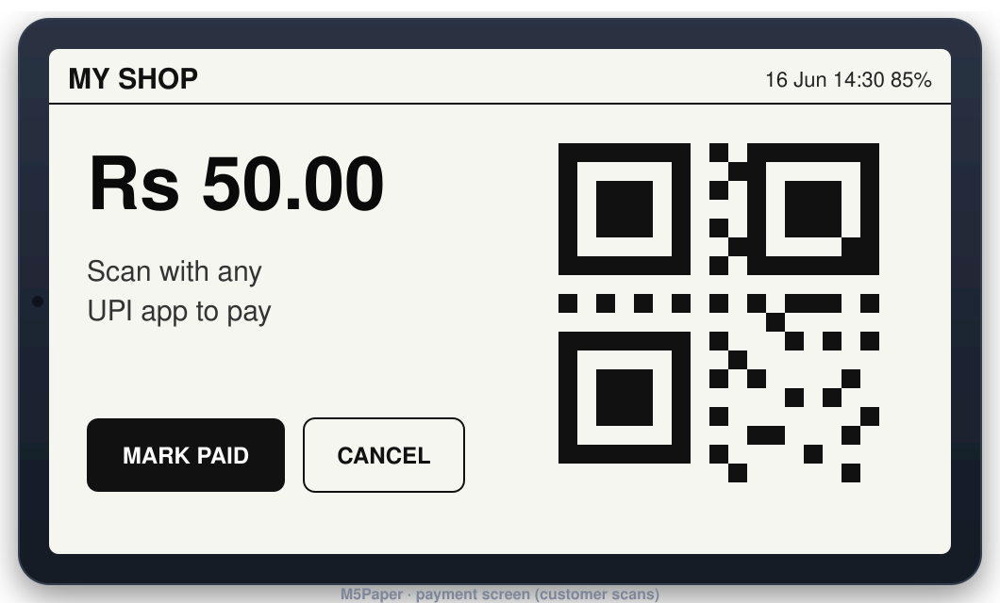
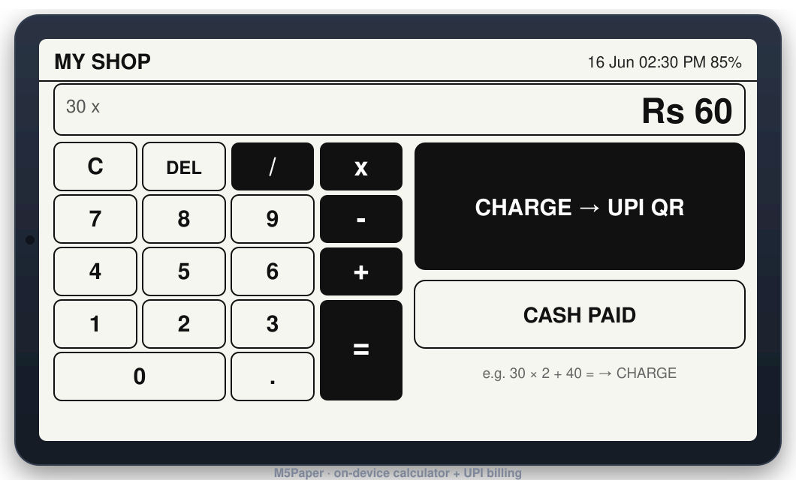
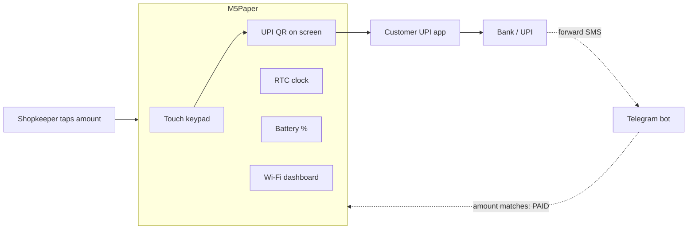

<p align="center">
  
</p>

<h1 align="center">M5PaperPay</h1>

<p align="center">
  <b>A touchscreen UPI payment counter for the M5Stack M5Paper.</b><br>
  Tap the amount &middot; show a big UPI QR to the customer &middot; mark paid &middot; log every sale &middot; no cloud
</p>

<p align="center">
  <a href="https://electroiot.github.io/M5-PaperPay/flasher/"><b>Install in your browser</b></a> &middot;
  <a href="docs/FLASHING.md">Flashing guide</a> &middot;
  <a href="#features">Features</a> &middot;
  <a href="#first-setup">First setup</a> &middot;
  <a href="docs/M5BURNER.md">M5Burner</a>
</p>

<p align="center"><sub>The pictures in this README are drawings of the screens, not photos.</sub></p>

## Screens

<table align="center"><tr>
  <td align="center"><br/><sub>1. Bill with the on-device calculator</sub></td>
  <td align="center"><br/><sub>2. Customer scans the QR</sub></td>
</tr></table>

## Features

- **On-device calculator** (`+ - x / =`), for example `30 x 2 + 40`, then **CHARGE** (UPI QR) or **CASH PAID**
- **Big UPI QR** facing the customer, with **MARK PAID** / **CANCEL**
- **Date, 12-hour time (RTC) and battery %** in the header, low-battery indicator
- **Payment log** on flash: today's sales, pending vs paid
- **Phone / PC dashboard** over Wi-Fi: calculator, payments, settings (`http://m5paperpay.local`)
- **Telegram bot (optional):** bill and paid alerts; forward the bank/UPI "credited Rs X" SMS and the
  matching bill is **marked paid automatically**
- **Captive-portal setup:** first boot opens a `M5PaperPay-Setup` Wi-Fi for Wi-Fi + UPI details
- Auto-return to the keypad after *Paid*; works with no app store and no cloud

## How it works



A bill becomes **Paid** in any of three ways: tap **MARK PAID**, tap **CASH PAID**, or forward the
bank/UPI "credited" SMS into Telegram.

## Install

- **Browser (easiest):** open the [web installer](https://electroiot.github.io/M5-PaperPay/flasher/) in Chrome or Edge.
- **M5Burner:** search *M5PaperPay* (device type PAPER).
- **esptool:** `esptool.py --chip esp32 --port COM17 write_flash 0x0 M5-PaperPay-v1.0.0-full.bin` from the [Releases](../../releases) page.
- **PlatformIO:** `git clone`, then `pio run -t upload` and `pio run -t uploadfs`.

A fresh install erases the M5Paper's saved settings. To update the app and keep your settings, flash
`-app.bin` at `0x10000` ([docs/FLASHING.md](docs/FLASHING.md)).

## First setup

1. Join the **M5PaperPay-Setup** Wi-Fi from your phone.
2. Enter your home Wi-Fi, **UPI ID (VPA)**, payee name and shop name.
3. Open `http://m5paperpay.local` for the dashboard and settings. Optional: add a Telegram bot token
   and chat id.

Your Wi-Fi, UPI ID and Telegram token are stored only on the device (NVS), never in this repository.

## Hardware

| | |
|---|---|
| Device | [M5Stack M5Paper](https://docs.m5stack.com/en/core/m5paper) - 4.7" e-ink 960x540, capacitive touch, RTC, battery, ESP32 16 MB |
| Libraries | M5Unified, M5GFX, QRCode, ArduinoJson, ESPAsyncWebServer, WiFiManager |

## Repository

```
src/ include/     firmware (display_m5.cpp = e-ink + touch UI; web/qrpay/store/telegram = logic)
data/             web dashboard (LittleFS)
platformio.ini    build config (m5stack-grey, 16 MB, LittleFS)
docs/             flashing guide, M5Burner guide, web installer (docs/flasher)
assets/           screen drawings
```

Based on the ESP32-S3 + Waveshare 2.9" e-paper build, [PaperPay](https://github.com/manoranjan2050/PaperPay).

## License

MIT - see [LICENSE](LICENSE).
